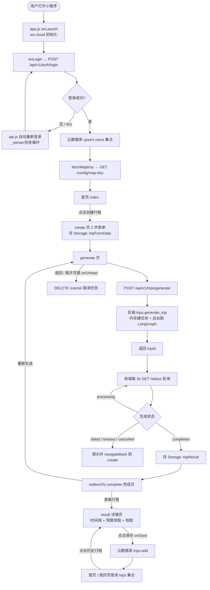
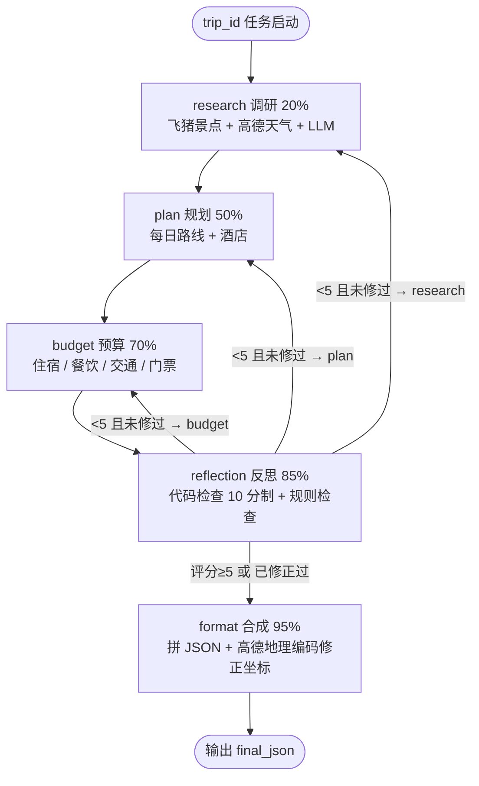
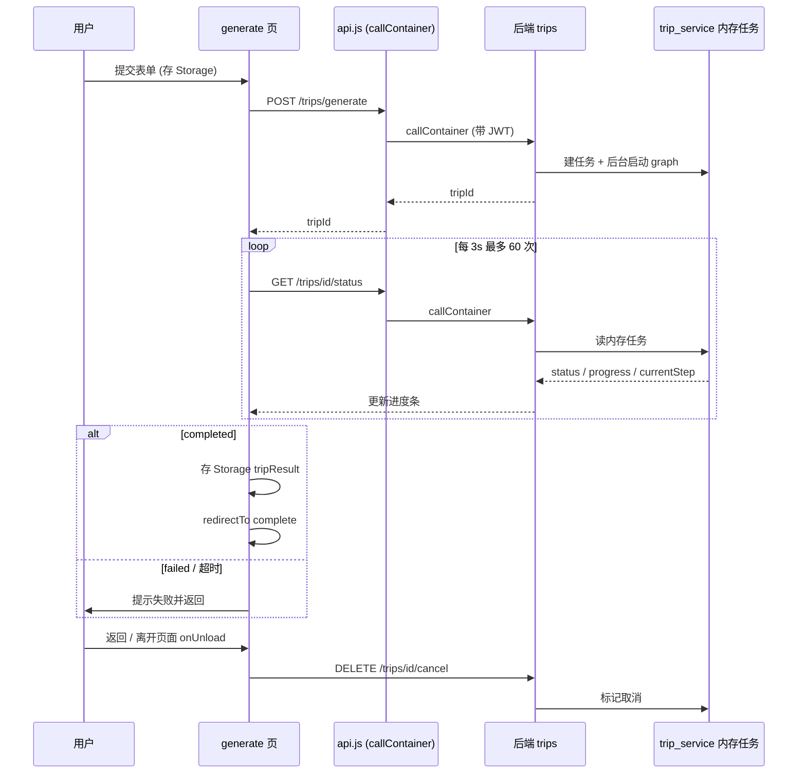

# AI 旅行规划系统

> 基于 **FastAPI + LangGraph + DeepSeek** 的多 Agent AI 旅行规划平台，微信小程序端，部署于腾讯云 CloudBase。

[](https://github.com/TencentCloudBase/CloudBase-AI-ToolKit)

## 项目架构

```
前端/
├── backend/                    # Python 后端 (FastAPI + LangGraph)
│   ├── main.py                 # 应用入口
│   ├── config.py               # 配置 + LLM 工厂
│   ├── api/v1/                 # RESTful API 路由
│   ├── agents/                 # 5-Agent LangGraph 工作流
│   ├── services/               # 业务逻辑层
│   ├── schemas/                # Pydantic 数据模型
│   ├── Dockerfile              # 容器化部署
│   └── .env                    # 环境变量 (不入 Git)
│
├── miniprogram/                # 微信小程序前端
│   ├── app.js                  # 入口 (云开发初始化/登录/安全区)
│   ├── pages/
│   │   ├── index/              # 首页 (热门目的地 + 最近行程)
│   │   ├── create/             # 创建行程 (2步表单)
│   │   ├── generate/           # AI 生成中 (进度轮询)
│   │   ├── complete/           # 生成完成摘要
│   │   ├── result/             # 行程详情 (时间线 + 预算饼图)
│   │   └── my/                 # 我的 (历史行程 + 统计)
│   └── utils/                  # 工具函数 (API/Storage/Mock)
│
├── project.config.json         # 微信小程序项目配置
└── cloudfunctions/             # 云函数 (备用)
```

## 系统流程图

> 以下流程图均基于仓库现有代码绘制，节点与箭头对应真实的页面跳转和接口调用（见各 `.js` / `.py` 源文件）。

### 1. 端到端主流程（用户打开 → 生成 → 保存 → 查看历史）



### 2. 后端 5-Agent LangGraph 工作流

`research → plan → budget → reflection` 为主链路，`reflection` 根据评分做条件路由：≥5 分或已修正过则进入 `format` 合成，否则回到对应 Agent 修正（最多 1 次，`revision_count` 防死循环）。百分比为前端进度条对应值。



### 3. 前端生成轮询与取消（时序图）

采用「异步任务 + 轮询」而非 WebSocket/SSE：后端立即返回 `tripId`，前端每 3 秒查一次状态，离开页面时主动取消。



## 技术栈

> 下表为仓库代码中实际使用的技术，按层归类并说明用途。

| 层级 | 技术 | 用途 / 对应位置 |
|------|------|----------------|
| AI 编排 | **LangGraph** + **LangChain** | 5 节点有状态工作流（research/plan/budget/reflection/format），支持条件路由与自修正循环；见 `backend/agents/graph.py` |
| 大模型 LLM | **DeepSeek**（默认），兼容 OpenAI / 混元 / 智谱 | 由 `config.get_llm` 工厂按 `LLM_PROVIDER` 切换；结构化输出用低温 `get_llm_structured` |
| 后端框架 | **FastAPI**（Python 3.12）+ **Pydantic v2** | RESTful API、请求/响应模型校验；`api/v1/*.py`、`schemas/trip.py` |
| 后端服务 | **Uvicorn**、**httpx**、**PyJWT** | ASGI 服务、异步 HTTP（微信登录/高德 MCP）、JWT 签发与鉴权 |
| Agent 工具 | **高德 MCP**（Model Context Protocol） | 天气 `maps_weather`、地理编码 `maps_geo`、POI 搜索、驾车路线；经 `_amap_mcp` 三步握手调用，会话缓存复用；见 `backend/agents/tools.py` |
| 外部数据 | **飞猪 FlyAI** CLI | 酒店 / 景点价格（RAG 增强），通过 `subprocess` 调用，未配置时自动降级为 LLM 知识库兜底 |
| 前端 | **微信小程序** 原生（WXML / WXSS / JS） | 页面 `pages/*`、自定义 TabBar、地图组件 |
| 前端通信 | **wx.cloud.callContainer** | 小程序 → 后端走云托管内网通道（带 `X-WX-SERVICE` 头 + JWT），无需配置 request 合法域名；见 `utils/api.js` |
| 前端数据 | **CloudBase 云数据库**（NoSQL）+ 小程序本地 Storage | `users` 集合（登录时 upsert）、`trips` 集合（result 页 onSave 写入，首页/我的页查询）；表单与生成结果用本地 Storage 做跨页缓存 |
| 坐标修正 | 高德地理编码 | `format` 节点用真实地址/名称修正 LLM 编造的经纬度（对抗幻觉），线程池并行 |
| 部署 | **Docker** + **CloudBase CloudRun**（容器型） | `backend/Dockerfile` 构建镜像，`cloudbaserc.json` 部署；规格 0.5C/1G，**实例固定为 1** |
| 测试 | **pytest** + **pytest-asyncio** + **FastAPI TestClient** + **pytest-benchmark** | 135 项用例覆盖 API / Agent / Service / Schema，含鉴权与归属校验 |
| 配置管理 | **Pydantic Settings** + `.env` | 密钥等敏感配置走环境变量，模板 `backend/.env.example` 入库，`.env` 不提交 |

## 部署信息

### 后端 (CloudBase CloudRun)

| 配置项 | 值 |
|--------|-----|
| 服务名称 | `ai-travel-backend` |
| 访问地址 | `https://ai-travel-backend-262776-10-1427844883.sh.run.tcloudbase.com` |
| 环境 ID | `cloud1-d2gzje1i7ba287acb` |
| 规格 | CPU 0.5核 / 内存 1GB |
| 实例 | **必须固定为 1**（任务状态存进程内存，多实例会导致轮询打到其他实例返回 `not_found`） |
| 端口 | 8080 |
| 最新版本 | `ai-travel-backend-006` |

**API 端点**：
- `GET /health` — 健康检查
- `POST /api/v1/trips/generate` — 提交行程生成
- `GET /api/v1/trips/{id}/status` — 查询生成进度
- `DELETE /api/v1/trips/{id}/cancel` — 取消生成
- `POST /api/v1/auth/login` — 微信登录
- `GET /api/v1/config/map-key` — 获取地图 Key

### 前端 (微信小程序)

- AppID: `wx0b239ce65bab54dc`
- 在微信开发者工具中打开 `miniprogram/` 目录即可运行
- 小程序通过 `wx.cloud.callContainer` 内网调用后端，无需域名配置

### CloudBase 资源

| 资源 | 用途 |
|------|------|
| CloudRun (ai-travel-backend) | 后端 API + AI Agent |
| 云数据库 (trips 集合) | 行程数据存储 |
| 云托管内网调用 | 小程序→后端通信 |

## 重新部署

```bash
# 后端：通过 CloudBase AI ToolKit 或 CLI 部署
tcb cloudrun deploy --service ai-travel-backend --path ./backend
```

## 部署前必读

- 生产环境必须设置 `JWT_SECRET`（随机 32 字节以上）。不设置时会使用代码里的默认值，存在被伪造 Token 的风险。
- `LLM_API_KEY`、`WX_SECRET`、`AMAP_KEY` 只放在 `.env` 或云托管环境变量里，不要提交到仓库；配置模板见 [backend/.env.example](backend/.env.example)。
- CloudRun 实例数固定为 1（原因见上表）。要扩实例必须先做任务状态持久化。
- `GET /api/v1/config/map-key`、行程进度/取消接口都需要登录 Token。
